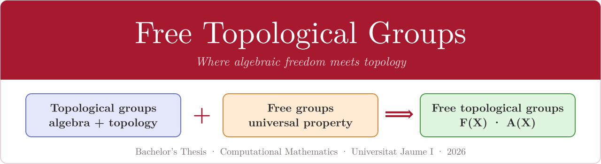
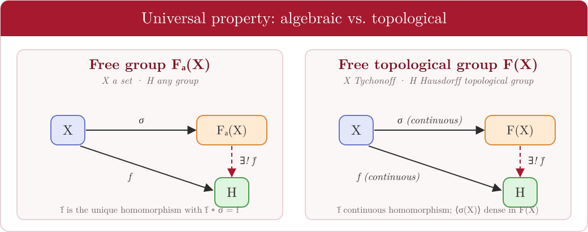
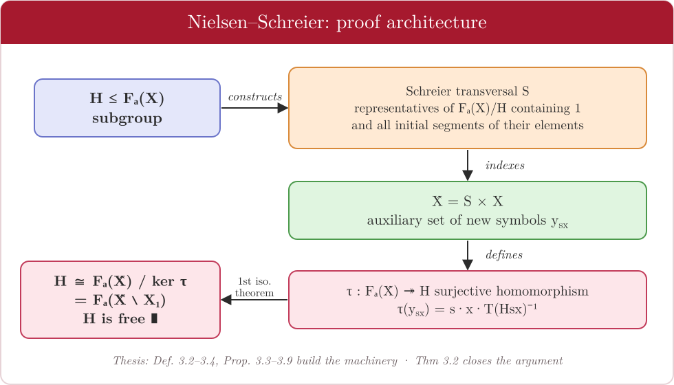
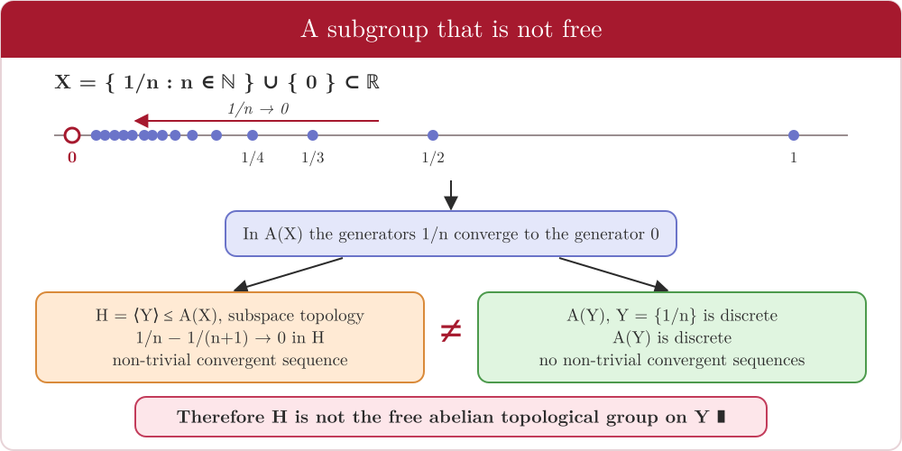
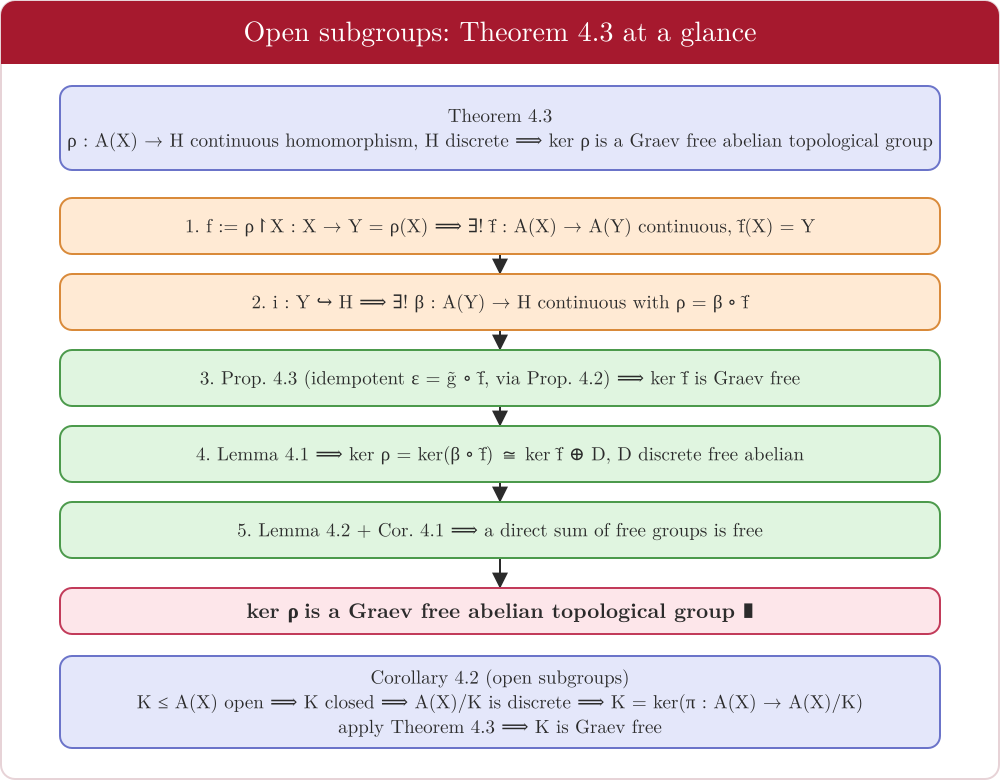
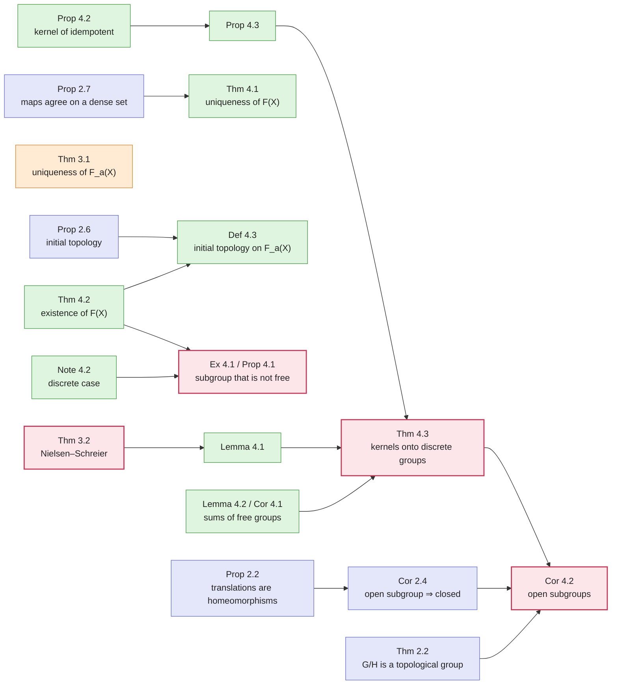
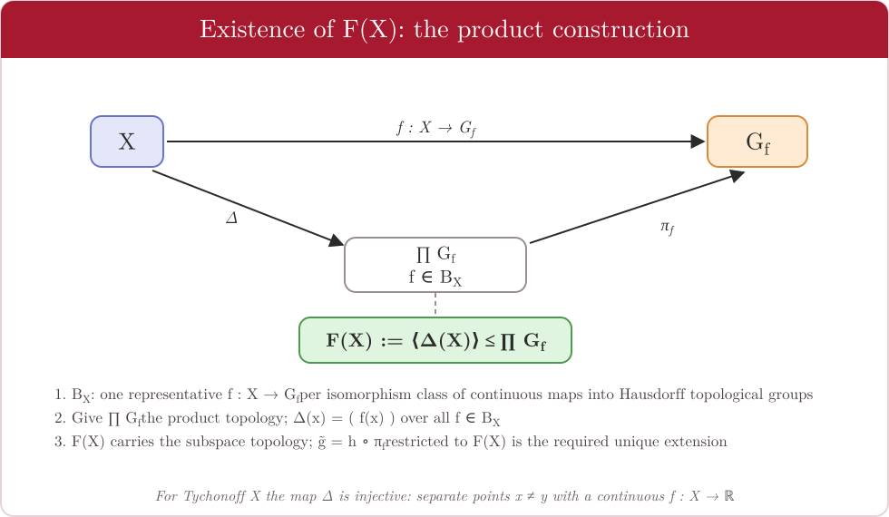

<p align="center">
  
</p>

<p align="center">
  
  
  
  
  
</p>

# Free Topological Groups

> **Can the notion of a *free group* be transported to the world of *topological groups*?**
> Yes — but the topology breaks one of the most famous theorems of combinatorial group theory, **Nielsen–Schreier**, and this repository shows exactly how, why, and when freedom can be recovered.

This repository accompanies my Bachelor's Thesis (*Trabajo Final de Grado*) in **Computational Mathematics** at the **Universitat Jaume I** (Castelló de la Plana, Spain), together with the slides used for its defence. The thesis is a self-contained, fully proved introduction to the theory of free topological groups; this README and the [`docs/`](docs/) folder are an English guide to what it does and what it proves.

| | |
|---|---|
| **Author** | Carlos Broch Cubedo |
| **Supervisors** | M.ª Vicenta Ferrer González · Salvador Hernández Muñoz |
| **Degree** | Grado en Matemática Computacional (Universitat Jaume I) |
| **Defence** | June 2026 · academic year 2025/2026 |
| **Documents** | 📄 [Thesis (PDF, 63 pp.)](thesis/TFG_Carlos_Broch_Cubedo.pdf) · 🎞️ [Slides (PDF, 29 slides)](slides/Presentation_CBC.pdf) |
| **Language of the PDFs** | Spanish (all documentation in this repository is in English) |

---

## Table of contents

1. [The big picture](#the-big-picture)
2. [Core idea: one universal property, two worlds](#core-idea-one-universal-property-two-worlds)
3. [Main results at a glance](#main-results-at-a-glance)
4. [The key contrast: Nielsen–Schreier fails](#the-key-contrast-nielsenschreier-fails)
5. [Recovering freedom: open subgroups](#recovering-freedom-open-subgroups)
6. [How the results depend on each other](#how-the-results-depend-on-each-other)
7. [Existence of F(X): the construction](#existence-of-fx-the-construction)
8. [Markov vs. Graev](#markov-vs-graev)
9. [A cryptographic perspective](#a-cryptographic-perspective)
10. [Repository layout and reading guide](#repository-layout-and-reading-guide)
11. [References](#references) · [Cite](#how-to-cite)

---

## The big picture

| | **Algebraic world** | **Topological world** |
|---|---|---|
| Object | Free group $F_a(X)$ on a set $X$ | Free topological group $F(X)$ on a space $X$ |
| Defined by | Universal property for **group homomorphisms** | Universal property for **continuous homomorphisms** |
| Elements | Reduced words in $X \cup X^{-1}$ | Same underlying group (for Tychonoff $X$), with a carefully chosen topology |
| Subgroups | **Always free** (Nielsen–Schreier) | **Not always free** — the topology can destroy freedom |
| Freedom is recovered when… | — | the subgroup is **open** (Graev setting), or a kernel of a continuous homomorphism onto a **discrete** group |

**What the thesis does, step by step**

1. **Topological groups** — definitions, neighbourhood calculus, quotients, topological isomorphisms, initial topologies. → [`docs/01`](docs/01-topological-groups.md)
2. **Free groups** — universal property, uniqueness, reduced words and normal forms. → [`docs/02`](docs/02-free-groups.md)
3. **Nielsen–Schreier** — a complete proof via Schreier transversals. → [`docs/03`](docs/03-nielsen-schreier.md)
4. **Free topological groups** — Markov's definition, uniqueness, existence for Tychonoff spaces, and a counterexample to heredity. → [`docs/04`](docs/04-free-topological-groups.md)
5. **Open subgroups of free abelian topological groups** — a partial topological analogue of Nielsen–Schreier. → [`docs/05`](docs/05-open-subgroups.md)

> **A note on "data".** This is a work of pure mathematics: there are no datasets or numerical experiments. The "results" are theorems, and the "data" are the definitions, constructions and explicit examples that support them. Everything is catalogued in the [theorem index](docs/theorem-index.md) with thesis page references.

---

## Core idea: one universal property, two worlds

A free object is characterised not by what it *is*, but by how it *maps*. The same commutative triangle defines both notions; the only change is that every map must now be **continuous**.

<p align="center">
  
</p>

* **Free group** $F_a(X)$: every function $f: X \to H$ into a group extends to a *unique* homomorphism $\tilde f : F_a(X) \to H$ with $\tilde f \circ \sigma = f$.
* **Free topological group** $F(X)$ (Markov): $\sigma : X \to F(X)$ is continuous, $\langle \sigma(X) \rangle$ is **dense**, and every *continuous* $f : X \to H$ into a **Hausdorff** topological group extends to a unique *continuous* homomorphism $\tilde f$.

The extra continuity requirement is what makes the topological construction delicate: it is no longer automatic that $\sigma$ is injective, and the algebraic freedom of $F(X)$ does not pass to its subgroups.

---

## Main results at a glance

| # | Result | Statement (informal) | Thesis |
|---|---|---|---|
| **Thm 3.1** | Uniqueness of free groups | Two free groups on $X$ are isomorphic compatibly with the embeddings. | p. 30 |
| **Thm 3.2** | **Nielsen–Schreier** | Every subgroup of a free group is free. | p. 40 |
| **Thm 4.1** | Uniqueness of $F(X)$ | Two free topological groups on $X$ are topologically isomorphic. | p. 43 |
| **Thm 4.2** | **Existence of $F(X)$** | For every Tychonoff space $X$, $F(X)$ exists, $\Delta : X \to F(X)$ is an embedding that generates it algebraically. | p. 44 |
| **Prop 4.1** | **Failure of heredity** | In $A(X)$ for $X=\{1/n\}\cup\{0\}$, the subgroup generated by $Y=\{1/n\}$ is *not* the free abelian topological group on $Y$. | p. 50 |
| **Thm 4.3** | **Kernels onto discrete groups** | If $\rho : A(X) \to H$ is a continuous homomorphism and $H$ is discrete, then $\ker\rho$ is a (Graev) free abelian topological group. | p. 58 |
| **Cor 4.2** | **Open subgroups** | Every open subgroup of a Graev free abelian topological group is again one. | p. 59 |

The full catalogue of numbered definitions, results and examples, with page references, lives in [`docs/theorem-index.md`](docs/theorem-index.md).

---

## The key contrast: Nielsen–Schreier fails

**Classical theorem (algebra).** Every subgroup $H \le F_a(X)$ is free. The proof builds a *Schreier transversal* $S$ for the cosets of $H$, an auxiliary alphabet $\hat X = S \times X$, a surjection $\tau : F_a(\hat X) \twoheadrightarrow H$, and finishes with the first isomorphism theorem.

<p align="center">
  
</p>

**Topological counterexample.** Let $X = \{1/n : n \in \mathbb N\} \cup \{0\} \subset \mathbb R$ — a convergent sequence together with its limit — and let $A(X)$ be the free abelian topological group on $X$. Let $H \le A(X)$ be the subgroup algebraically generated by $Y = \{1/n\}$, with the topology inherited from $A(X)$.

* $Y$ has no limit point inside itself, so $Y$ is **discrete**, hence $A(Y)$ is **discrete** and has no non-trivial convergent sequences.
* But in $H$, the sequence $\tfrac1n - \tfrac1{n+1}$ converges to $0$ **(non-trivially)**.

So $H$ cannot be $A(Y)$: **the topology breaks the inheritance of freedom.**

<p align="center">
  
</p>

> The thesis also records (citing Arkhangel'skii–Tkachenko) that $H$ is in fact not topologically isomorphic to *any* free topological group.

---

## Recovering freedom: open subgroups

The negative result is not the end of the story. Working in **Graev's** framework (pointed spaces), the thesis proves a positive result — the partial topological analogue of Nielsen–Schreier:

> **Theorem 4.3.** Let $A(X)$ be a Graev free abelian topological group and $\rho : A(X) \to H$ a continuous homomorphism into a **discrete** group. Then $\ker \rho$ is a Graev free abelian topological group.
>
> **Corollary 4.2.** Every **open** subgroup of $A(X)$ is a Graev free abelian topological group.

*Why the corollary follows.* An open subgroup $K$ is also closed, so $A(X)/K$ is a topological group; it is discrete because each coset is open; and $K = \ker(A(X) \to A(X)/K)$, so Theorem 4.3 applies.

<p align="center">
  
</p>

The proof combines an **idempotent-endomorphism trick** (Prop. 4.2: if $\varepsilon^2=\varepsilon$ and $\varepsilon(X)\subseteq X$, then $\ker\varepsilon$ is free with basis $\{x-\varepsilon(x)\}$), a **splitting lemma** (Lemma 4.1), and **closure under direct sums** (Lemma 4.2). The thesis also notes where the Axiom of Choice enters (Note 4.6).

---

## How the results depend on each other



---

## Existence of F(X): the construction

The proof of existence (Markov's theorem, in Kakutani's formulation) builds $F(X)$ **inside a giant product** of Hausdorff topological groups. Since the class of all continuous maps out of $X$ is too large to index a product, the thesis first passes to one representative per isomorphism class.

<p align="center">
  
</p>

Section 4.2 then closes the loop between the two viewpoints: it endows the *algebraic* free group $F_a(X)$ with the **initial topology** induced by all homomorphisms that are continuous on $X$, and checks that the result satisfies the universal property. When $X$ is **discrete**, the construction collapses beautifully: $F_a(X)$ with the discrete topology *is* $F(X)$.

---

## Markov vs. Graev

There are two standard flavours of the free abelian topological group:

| | **Markov** $A_M(X)$ | **Graev** $A_G(X)$ |
|---|---|---|
| Base | A Tychonoff space $X$ | A *pointed* Tychonoff space $(X, x_0)$ |
| Maps | continuous $f : X \to G$ | continuous $f : X \to G$ with $f(x_0)=0$ |
| Free algebraic basis | $X$ | $X \setminus \{x_0\}$ |
| Relation | $A_M(X) \cong A_G(X) \oplus \mathbb Z$ | |
| Open subgroups | free (Markov) **iff totally disconnected** (Brazas) | **always** free (Graev) |

The positive results of Chapter 4.4 are therefore proved in the **Graev** setting, where they hold in full generality.

---

## A cryptographic perspective

The thesis closes with a remark connecting the theory to **post-quantum group-based cryptography**. Protocols such as *Anshel–Anshel–Goldfeld* rely on the hardness of the **Conjugacy Search Problem** in non-abelian groups, and one possible attack tries to find a free basis of the subgroup generated by the public keys, shrinking the search space. In free topological groups, the *non-inheritance of freedom by subgroups* means this strategy is unavailable: the topology masks the algebraic structure and renders standard combinatorial algorithms inapplicable. The thesis presents this as a perspective, not as a worked cryptographic result.

---

## Repository layout and reading guide

```text
free-topological-groups/
├── README.md                    ← you are here
├── thesis/
│   └── TFG_Carlos_Broch_Cubedo.pdf        full thesis (Spanish, 63 pp.)
├── slides/
│   └── Presentation_CBC.pdf               defence slides (Spanish, 29 slides)
├── docs/                        English guide to the mathematics
│   ├── 01-topological-groups.md
│   ├── 02-free-groups.md
│   ├── 03-nielsen-schreier.md
│   ├── 04-free-topological-groups.md
│   ├── 05-open-subgroups.md
│   ├── theorem-index.md                   every numbered result, with page refs
│   └── glossary.md                        English ↔ Spanish terminology
├── assets/                      diagrams (SVG), same palette as the slides
├── CITATION.cff
└── .gitignore
```

**Suggested reading paths**

* ⏱️ **5 minutes** — this README.
* 🧭 **Fast track to the punchline** — [`docs/03`](docs/03-nielsen-schreier.md) → [`docs/04`](docs/04-free-topological-groups.md) (§ counterexample) → [`docs/05`](docs/05-open-subgroups.md).
* 📚 **Full path** — `docs/01` → `docs/05` in order, with the thesis open alongside for complete proofs.
* 🇪🇸 **Spanish terms?** — see the [glossary](docs/glossary.md).

---

## References

Selected from the thesis bibliography (full list in the thesis):

1. A. V. Arkhangel'skii, M. Tkachenko — *Topological Groups and Related Structures*, Atlantis Press/World Scientific, 2008.
2. J. Brazas — *Open subgroups of free topological groups*, arXiv:1209.5486, 2013.
3. E. Hewitt, K. A. Ross — *Abstract Harmonic Analysis, Vol. I*, Springer, 1963.
4. S. Kakutani — *Free topological groups and infinite direct product topological groups*, Proc. Imp. Acad. 20(8), 1944, 595–598.
5. S. A. Morris, V. G. Pestov — *Open subgroups of free abelian topological groups*, Math. Proc. Cambridge Philos. Soc. 114, 1993, 439–442.
6. D. J. S. Robinson — *A Course in the Theory of Groups*, Springer, 1996.

*Historical note:* free topological groups were introduced by **A. A. Markov** (1941), who proved their existence over Tychonoff spaces; the theory was later simplified and extended by **Kakutani** and **Graev**.

## How to cite

```bibtex
@thesis{BrochCubedo2026FreeTopologicalGroups,
  author      = {Broch Cubedo, Carlos},
  title       = {Grupos Topológicos Libres},
  type        = {Bachelor's thesis},
  institution = {Universitat Jaume I},
  address     = {Castelló de la Plana, Spain},
  year        = {2026},
  note        = {Supervisors: M.ª Vicenta Ferrer González and Salvador Hernández Muñoz}
}
```

GitHub's **“Cite this repository”** button is powered by [`CITATION.cff`](CITATION.cff).

## Acknowledgements

To my supervisors, M.ª Vicenta Ferrer González and Salvador Hernández Muñoz, for their guidance, patience and rigour throughout this project.
