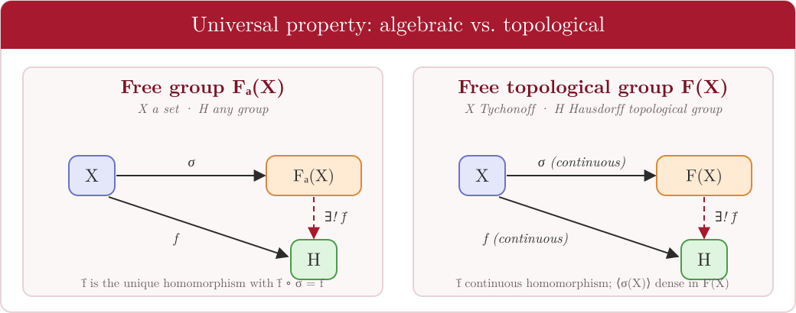

# 2 · Free groups

← [Topological groups](01-topological-groups.md) · [README](../README.md) · Next: [Nielsen–Schreier →](03-nielsen-schreier.md)
*Thesis: Chapter 3, §3.1, pp. 29–33.*

A free group on a set $X$ has no relations among its generators other than the trivial ones. Every group is a quotient of a free group, which makes these groups central in combinatorial group theory.

---

## Definition by universal property

> **Definition 3.1.** Let $X\neq\varnothing$. A group $G$ with a map $\sigma:X\to G$ is the **free group on $X$** if
> 1. $\langle\sigma(X)\rangle=G$, and
> 2. for every group $H$ and every map $f:X\to H$ there is a **unique** homomorphism $\tilde f:G\to H$ with $\tilde f\circ\sigma=f$.

The same definition with $G,H$ abelian gives the **free abelian group** $A_a(X)$.

| Result | Statement | Proof idea |
|---|---|---|
| **Thm 3.1** (uniqueness) | Two free groups $(G_1,\sigma_1)$, $(G_2,\sigma_2)$ on $X$ are isomorphic, compatibly with $\sigma_i$. | Build $\phi_1:G_1\to G_2$ and $\phi_2:G_2\to G_1$ from the universal property; $\phi_2\phi_1$ fixes the generators $\sigma_1(X)$, hence is the identity. |
| **Prop 3.1** | $\sigma$ is injective, so $X\subseteq F_a(X)$. | If $x\ne y$, map $x\mapsto1$, $y\mapsto2$, others $\mapsto 0$ into $(\mathbb Z,+)$; $\sigma(x)=\sigma(y)$ would force $1=2$. |
| **Prop 3.2** | A bijection $X\to Y$ induces an isomorphism $F_a(X)\cong F_a(Y)$. | Extend $\varphi$ and $\varphi^{-1}$; the composites are the identity on generators. |

**Notation.** $F_a(X)$ is the free group and $A_a(X)$ the free abelian group on $X$; $X$ is a **free basis**.

---

## Concrete description: reduced words

Elements of $F_a(X)$ are finite words in $X\cup X^{-1}$, up to cancelling $xx^{-1}$ and $x^{-1}x$.

| Notion | Description |
|---|---|
| **Reduced form** | Unique expression $x_1^{\epsilon_1}\cdots x_n^{\epsilon_n}$ with $\epsilon_i=\pm1$ and no cancelling neighbours; $n$ is the **length**. |
| **Normal form** | Unique expression $x_1^{r_1}\cdots x_n^{r_n}$ with consecutive $x_i$ distinct and $r_i\in\mathbb Z\setminus\{0\}$. |
| **Empty word** | The identity, written $1$. |

**Multiplication in normal form.** For $x_1^{r_1}\cdots x_\ell^{r_\ell}\cdot y_1^{m_1}\cdots y_k^{m_k}$:

$$
\begin{cases}
x_1^{r_1}\cdots x_\ell^{r_\ell}\,y_1^{m_1}\cdots y_k^{m_k} & \text{if } x_\ell\neq y_1,\\[2pt]
x_1^{r_1}\cdots x_\ell^{\,r_\ell+m_1}\,y_2^{m_2}\cdots y_k^{m_k} & \text{if } x_\ell=y_1,\ r_\ell+m_1\neq0,\\[2pt]
(x_1^{r_1}\cdots x_{\ell-1}^{r_{\ell-1}})(y_2^{m_2}\cdots y_k^{m_k}) & \text{if } x_\ell=y_1,\ r_\ell+m_1=0.
\end{cases}
$$

*Tiny example in $F_a(\{a,b\})$:* $(a\,b^{2})(b^{-2}\,a^{3}) = a\cdot a^{3}=a^{4}$ (the $b$-exponents cancel, and the neighbouring $a$ powers merge).

**Abelian case.** Elements of $A_a(X)$ are $r_1x_1+\cdots+r_nx_n$ with $r_i\in\mathbb Z\setminus\{0\}$ and distinct $x_i$; addition adds coefficients and inverses negate them.

---

← [Topological groups](01-topological-groups.md) · [README](../README.md) · Next: [Nielsen–Schreier →](03-nielsen-schreier.md)
