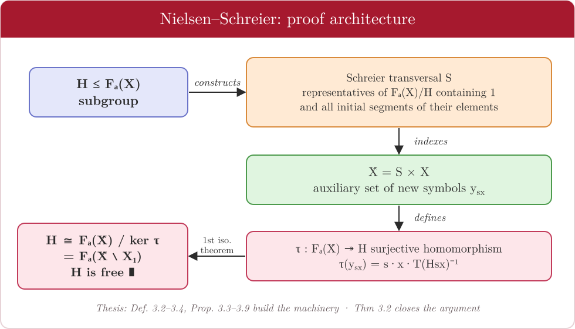

# 3 · The Nielsen–Schreier theorem

← [Free groups](02-free-groups.md) · [README](../README.md) · Next: [Free topological groups →](04-free-topological-groups.md)
*Thesis: Chapter 3, §3.2, pp. 33–40.*

> **Theorem 3.2 (Nielsen–Schreier).** Let $F_a(X)$ be a free group and $H\le F_a(X)$ a subgroup. Then $H$ is also a free group.

This is the benchmark the rest of the thesis is measured against: in the topological setting the analogous statement **fails** ([Chapter 4](04-free-topological-groups.md)) and holds only under extra hypotheses ([Chapter 4.4](05-open-subgroups.md)).

---

## The strategy in one paragraph

Pick a representative $s$ for every right coset $Hg$ (a *cross-section*, or transversal). Build a new alphabet $\hat X=\{y_{sx}: s\in S,\ x\in X\}$ with one symbol per pair $(s,x)$, and send $y_{sx}\mapsto s\,x\,T(Hsx)^{-1}\in H$. This defines a **surjection** $\tau:F_a(\hat X)\twoheadrightarrow H$. If the transversal is chosen with the **Schreier property**, the kernel of $\tau$ is generated (as a normal subgroup) by *some of the generators themselves*, so killing them leaves a free group on the rest.

---

## Step by step

| Step | Result | Content |
|---|---|---|
| 1 | **Def 3.2, Lemma 3.1** | A *cross-section* $T:F_a(X)/H\to F_a(X)$ chooses one representative per coset; we may take $T(H)=1$. Then $su\,T(Hsu)^{-1}\in H$. |
| 2 | **Prop 3.3** | With $\hat X=S\times X$ and $\hat F=F_a(\hat X)$, the assignment $y_{sx}\mapsto sx\,T(Hsx)^{-1}$ is well defined; by the universal property it extends to a homomorphism $\tau:\hat F\to H$ (the **representation** of $H$). |
| 3 | **Def 3.3, Props 3.4–3.5** | *Rewriting process*: for $u\in F_a(X)$, $s\in S$ define $u^{H_s}\in\hat F$ recursively. It satisfies $(uv)^{H_s}=u^{H_s}\,v^{H_{su}}$ and $\tau(u^{H_s})=s\,u\,T(Hsu)^{-1}$. |
| 4 | **Prop 3.6** | $\psi:H\to\hat F$, $u\mapsto u^{H}$, is a homomorphism with $\tau\circ\psi=\mathrm{id}_H$. Hence **$\tau$ is surjective**. |
| 5 | **Props 3.7–3.8** | With $\chi=\psi\circ\tau$, $\ker\tau=\ker\chi$ is the **normal closure** of the relators $u^{H}$ for $1\ne u\in S$ (equivalently of $y_{sx}^{-1}\chi(y_{sx})$). |
| 6 | **Def 3.4, Prop 3.9** | A transversal $S$ has the **Schreier property** if every initial segment of an element of $S$ is in $S$. Such a transversal **exists** — built by induction on the *length of a coset* $\ell(Hg)=\min\{\ell(w): w\in Hg\}$, setting $T(Hg)=T(Hv)\,y$ when $u=vy$ is a shortest representative. |
| 7 | **Thm 3.2** | For a Schreier transversal, each relator $u^H$ with $u=vx^\epsilon$ factors as $v^H\,y_{vx}^{\epsilon}$, and $v^H$ is again a relator; hence some generators $y_{vx}$ already lie in $K=\ker\tau$. Let $X_1\subseteq\hat X$ be those. The classes of the remaining generators form a free basis of $\hat F/K$, and by the **first isomorphism theorem** $H\cong\hat F/K$ is free. ∎ |

---

## Why Schreier transversals matter

Without the Schreier property the relators $u^{H}$ are complicated words in the $y_{sx}$. With it, every non-trivial relator is *one generator times an earlier relator*, so the kernel is generated by single generators and the quotient is immediately free on the surviving ones. The induction in Prop 3.9 is what guarantees such a transversal always exists.

---

← [Free groups](02-free-groups.md) · [README](../README.md) · Next: [Free topological groups →](04-free-topological-groups.md)
