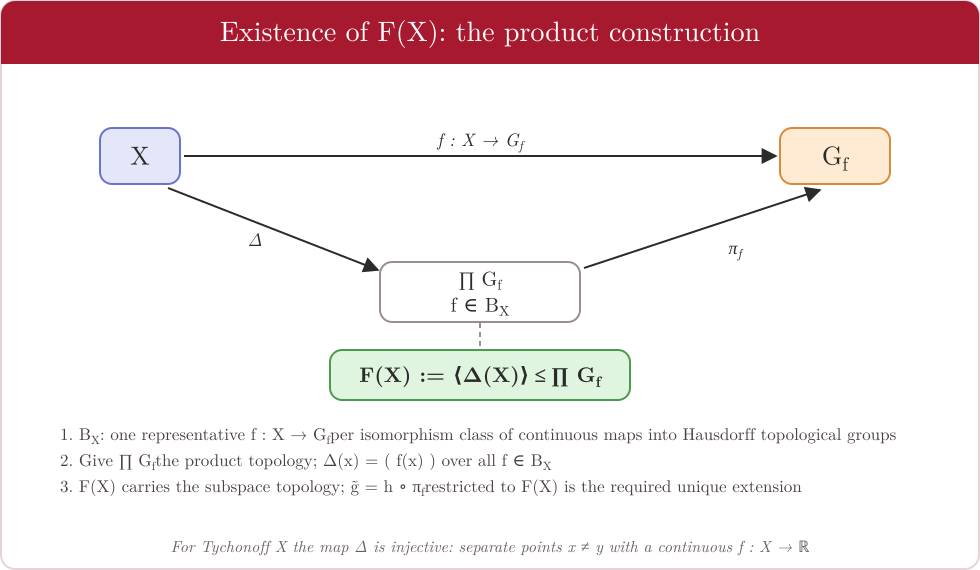
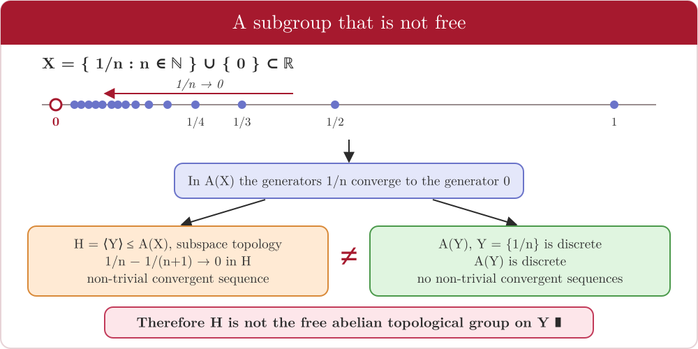

# 4 · Free topological groups

← [Nielsen–Schreier](03-nielsen-schreier.md) · [README](../README.md) · Next: [Open subgroups →](05-open-subgroups.md)
*Thesis: Chapter 4, §§4.1–4.3, pp. 41–51.*

The heart of the thesis: transport the universal property of free groups to **topological spaces** and **continuous homomorphisms**.

> **Guiding question.** Given a topological space $X$, is there a topological group $F(X)$ into which $X$ embeds continuously, such that *every continuous map* $f:X\to H$ into a topological group extends to a *unique continuous homomorphism* $F(X)\to H$?

The answer is yes for Tychonoff spaces, but the extra continuity makes things subtle — in particular it is no longer automatic that $\sigma$ is injective.

---

## Markov's definition

> **Definition 4.1.** Let $X\ne\varnothing$ be a topological space. A **Hausdorff** topological group $G$ with a continuous $\sigma:X\to G$ is the **free topological group of Markov** on $X$ if
> 1. $\langle\sigma(X)\rangle$ is **dense** in $G$, and
> 2. for every Hausdorff topological group $H$ and continuous $f:X\to H$ there is a **unique continuous homomorphism** $\tilde f:G\to H$ with $\tilde f\circ\sigma=f$.

If $G,H$ are also abelian we get the **free abelian topological group** $A(X)$. *(Notation: $F(X)$ multiplicative, $A(X)$ additive — Note 4.1.)*

### Uniqueness — Theorem 4.1

Any two free topological groups on $X$ are **topologically isomorphic**, compatibly with the embeddings.

> **Proof sketch.** The universal property gives continuous homomorphisms $\phi_1:G_1\to G_2$ and $\phi_2:G_2\to G_1$. Then $\phi_2\phi_1$ is continuous, fixes $\sigma_1(X)$, and hence the dense subgroup $\langle\sigma_1(X)\rangle$; since $G_1$ is Hausdorff, **Prop 2.7** gives $\phi_2\phi_1=\mathrm{id}$. Same for the other composite. So $\phi_1$ is a group isomorphism with continuous inverse. ∎

### The easiest case — discrete spaces (Note 4.2)

If $X$ is **discrete**, then $F_a(X)$ with the **discrete topology** is the free topological group on $X$ (and likewise for $A_a(X)$): every homomorphism out of a discrete group is automatically continuous, so the algebraic universal property already gives the topological one.

---

## Existence — Theorem 4.2

> **Theorem 4.2.** For every **Tychonoff** space $X$ (Hausdorff and completely regular) the free topological group $F(X)$ exists, together with a continuous $\Delta:X\to F(X)$ such that
> 1. $\Delta$ generates $F(X)$ algebraically;
> 2. (universal property) every continuous $g:X\to H$ into a Hausdorff topological group extends to a unique continuous homomorphism $\tilde g$ with $\tilde g\circ\Delta=g$;
> 3. $\Delta$ is an embedding.

**Construction.**

1. Take *all* continuous maps $f:X\to G_f$ into Hausdorff topological groups. This collection is **too large to be a set**, so identify $f_1\sim f_2$ when $f_2=h\circ f_1$ for a topological isomorphism $h$, and choose one representative per class: a set $\mathcal B_X$.
2. Form $\prod_{f\in\mathcal B_X}G_f$ with the product topology (a topological group) and the diagonal map $\Delta(x)=(f(x))_{f}$.
3. Define $F(X):=\langle\Delta(X)\rangle\le\prod G_f$ with the subspace topology.
4. **Universal property.** Given $g:X\to H$, pick $f\in\mathcal B_X$ with $f\sim g$ via $h_{fg}:G_f\to H$, and put $\tilde g=h_{fg}\circ\pi_f|_{F(X)}$. It is a continuous homomorphism with $\tilde g\circ\Delta=g$.
5. **Injectivity.** If $x\ne y$, complete regularity gives continuous $f:X\to\mathbb R$ with $f(x)=0$, $f(y)=1$; if $\Delta(x)=\Delta(y)$ then $0=\tilde f(\Delta(x))=\tilde f(\Delta(y))=1$, absurd.

*(Note 4.3: for Tychonoff $X$, $F(X)$ is itself Tychonoff — proved in Arkhangel'skii–Tkachenko, not reproduced in the thesis.)*

---

## From the universal property to a constructive topology

**§4.2 (Def 4.3).** Instead of building $F(X)$ in a product, start from the *algebraic* free group $F_a(X)$ and give it the **initial topology** ([Def 2.4](01-topological-groups.md#initial-topology-generated-by-homomorphisms)) generated by all homomorphisms $\varphi:F_a(X)\to(G_\varphi,\tau_\varphi)$ whose restriction to $X$ is continuous (one representative per class). The thesis checks that $(F_a(X),\tau)$ satisfies the universal property.

> **Take-away.** One does not need to build the topological group from scratch: it suffices to put the right topology on the algebraic free group.

---

## The key counterexample — freedom is not hereditary

> **Example 4.1.** Let $X=\{\tfrac1n : n\in\mathbb N\}\cup\{0\}\subset\mathbb R$ (a convergent sequence and its limit) and $A(X)$ its free abelian topological group. In $A(X)$ the sequence of generators $\tfrac1n$ converges to the generator $0$. Let $H\le A(X)$ be the subgroup **algebraically generated** by $Y=\{\tfrac1n:n\in\mathbb N\}$, with the subspace topology.
>
> **Proposition 4.1.** $H$ is **not** the free abelian topological group on $Y$.

**Proof.**
1. $Y\subset\mathbb R$ does not contain its limit point $0$, so every point of $Y$ is isolated: **$Y$ is discrete**.
2. If $H$ were $A(Y)$, then — since $Y$ is discrete — $A(Y)$ would be **discrete** (Note 4.2), with no non-constant convergent sequences.
3. But in $H$ with the topology inherited from $A(X)$, the sequence $\tfrac1n-\tfrac1{n+1}$ converges to $0$ (the identity). **Contradiction.** ∎

**Note 4.4** (citing Arkhangel'skii–Tkachenko): $H$ is in fact not topologically isomorphic to *any* free topological group.

**Moral.** Algebraically, $\langle Y\rangle$ is a free abelian group on $Y$. But the topology inherited from the bigger group remembers the limit point $0$, so the subgroup is not *topologically* free. Compare with [Nielsen–Schreier](03-nielsen-schreier.md), where no such obstruction exists.

---

← [Nielsen–Schreier](03-nielsen-schreier.md) · [README](../README.md) · Next: [Open subgroups →](05-open-subgroups.md)
