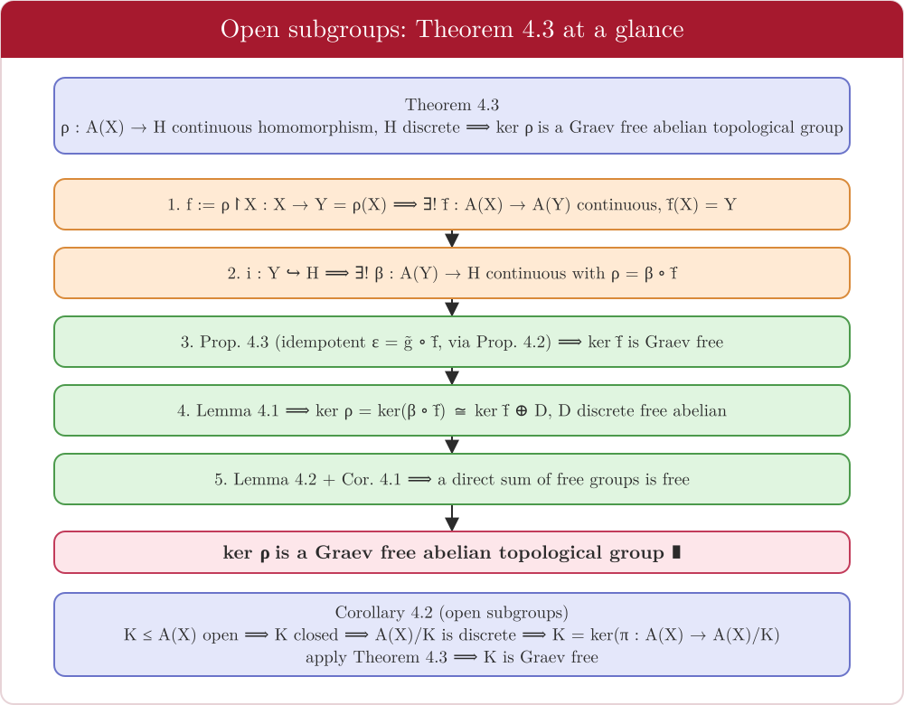

# 5 · Open subgroups of free abelian topological groups

← [Free topological groups](04-free-topological-groups.md) · [README](../README.md)
*Thesis: Chapter 4, §4.4, pp. 51–59 · Slides 21–25.*

[Chapter 4](04-free-topological-groups.md) showed that subgroups of free topological groups need not be free. This chapter shows **which subgroups do inherit freedom**: the *open* ones, in the right framework.

---

## Which "free"? Markov vs. Graev

| | Markov $A_M(X)$ | Graev $A_G(X)$ |
|---|---|---|
| Input | Tychonoff $X$ | **Pointed** Tychonoff space $(X,x_0)$ |
| Maps | continuous | continuous with $f(x_0)=0_G$ |
| Algebraic basis | $X$ | $X\setminus\{x_0\}$ |
| Relation | $A_M(X)\cong A_G(X)\oplus\mathbb Z$ | |

Both exist and are unique up to topological isomorphism (Note 4.5). The choice of base point does not matter up to isomorphism.

* **Brazas' dichotomy (cited in the thesis):** an open subgroup of a **Graev** free topological group is always Graev free; an open subgroup of a **Markov** free topological group is Markov free **iff it is totally disconnected**.
* The thesis therefore works in the **Graev** setting, writing $A(X)=A_G(X)$.

> **Definition 4.4 (pointed space).** A pair $(X,x_0)$; morphisms are continuous maps with $f(x_0)=y_0$.
> **Definition 4.5 (Graev).** $A_G(X)$ is a topological abelian group with an embedding $X\hookrightarrow A_G(X)$ sending $x_0\mapsto0$, such that every continuous pointed map $f:X\to G$ into an abelian topological group extends uniquely to a continuous homomorphism $\tilde f:A_G(X)\to G$.

---

## Main theorem

> **Theorem 4.3.** Let $A(X)$ be a Graev free abelian topological group and $\rho:A(X)\to H$ a continuous homomorphism into a **discrete** group. Then $\ker\rho$ is a Graev free abelian topological group.
>
> **Corollary 4.2.** Every **open** subgroup of a Graev free abelian topological group is a Graev free abelian topological group.

---

## The ingredients

| Result | Statement | Idea |
|---|---|---|
| **Prop 4.2** | If $\varepsilon:A(X)\to A(X)$ is a continuous **idempotent** endomorphism with $\varepsilon(X)\subseteq X$, then $\ker\varepsilon$ is Graev free, with free basis $Z=\psi(X)=\{x-\varepsilon(x)\}$. | $\psi=\mathrm{id}-\varepsilon$ is idempotent with image $\ker\varepsilon$. A pointed map $\phi:Z\to G$ extends via $\mu:A(X)\to G$ with $\mu\vert_X=\phi\circ\psi\vert_X$, and $\mu\circ\varepsilon=0$ on $X$; restrict $\mu$ to $\ker\varepsilon$. *(No Axiom of Choice needed.)* |
| **Prop 4.3** | If $\tilde f:A(X)\to A(Y)$ is a continuous homomorphism onto a **discrete** free group with $\tilde f(X)=Y$, then $\ker\tilde f$ is Graev free. | Choose a section $g:Y\to X$ with $\tilde f g=\mathrm{id}$; extend to $\tilde g:A(Y)\to A(X)$; then $\varepsilon=\tilde g\tilde f$ is idempotent, $\ker\varepsilon=\ker\tilde f$, and Prop 4.2 applies. |
| **Lemma 4.1** | $\ker(\beta\circ\tilde f)\cong\ker\tilde f\;\oplus\;D$ with $D$ a **discrete** free abelian group. | $\ker(\beta\tilde f)=\tilde f^{-1}(\ker\beta)$. The abelian **Schreier theorem** (Thm 3.2) makes $\ker\beta$ free; $\tilde g$ embeds it as $D=\tilde g(\ker\beta)$, and $\tilde g(\ker\beta)\cap\ker\tilde f=\{0\}$. |
| **Def 4.6, Def 4.7** | Topological direct sum $A\oplus B$ (product topology) and topological sum $X\sqcup Y$ (disjoint union). | |
| **Lemma 4.2 / Cor 4.1** | $A(X_1)\oplus A(X_2)\cong A(X_1\sqcup X_2)$; the same for Graev groups by identifying base points. | Extend $\varphi_1,\varphi_2$ separately and add: $\tilde\varphi(z_1+z_2)=\tilde\varphi_1(z_1)+\tilde\varphi_2(z_2)$. |

---

## Proof of Theorem 4.3, in five lines

1. $f:=\rho\vert_X:X\to Y=\rho(X)$ gives a unique continuous $\tilde f:A(X)\to A(Y)$ with $\tilde f(X)=Y$.
2. The inclusion $i:Y\hookrightarrow H$ gives a unique continuous $\beta:A(Y)\to H$ with $\rho=\beta\circ\tilde f$ (both agree on $X$, so they agree everywhere).
3. **Prop 4.3** $\Rightarrow$ $\ker\tilde f$ is Graev free.
4. **Lemma 4.1** $\Rightarrow$ $\ker\rho=\ker(\beta\circ\tilde f)\cong\ker\tilde f\oplus D$, $D$ discrete free abelian.
5. **Lemma 4.2 + Cor 4.1** $\Rightarrow$ the direct sum is Graev free. ∎

## Proof of Corollary 4.2

Let $K\le A(X)$ be open.
* $K$ is **closed** (Cor 2.4), so $A(X)/K$ is a topological group (Thm 2.2).
* $A(X)/K$ is **discrete**: each coset $z+K$ is open in $A(X)$ and equals $\pi^{-1}(\{z+K\})$, so $\{z+K\}$ is open in the quotient.
* $K=\ker(\pi:A(X)\to A(X)/K)$ with $\pi$ continuous onto a discrete group, so Theorem 4.3 gives that $K$ is Graev free. ∎

---

## Where the Axiom of Choice appears (Note 4.6)

Prop 4.2 is choice-free. The thesis notes that the proofs of **Prop 4.3** and **Lemma 4.1** use the Axiom of Choice (twice in total), because of the use of Schreier's theorem.

## Closing picture

| | Free groups | Free topological groups |
|---|---|---|
| Subgroups | all free (Nielsen–Schreier) | **not all** free ([Prop 4.1](04-free-topological-groups.md#the-key-counterexample--freedom-is-not-hereditary)) |
| Recovered for | — | **open** subgroups (Graev); kernels onto discrete groups |
| Markov version | — | open subgroups free iff totally disconnected |

---

← [Free topological groups](04-free-topological-groups.md) · [README](../README.md)
